  

I build web apps end to end: React frontend, Node/Express API, relational database, tests.
Currently learning Java + Spring Boot at Campuslands.

### Projects

| | What it is | Built with | |
|---|---|---|---|
| **Emirate Scents** | Full-stack perfume store | React 19 · Express 5 · Prisma · PostgreSQL · Vitest · Playwright | [demo](https://sebastianjaimesr.github.io/emirate-scents/) · [code](https://github.com/sebastianjaimesr/emirate-scents) |
| **AgendaBot** | Telegram productivity assistant | n8n (self-hosted) · Telegram API | [code](https://github.com/sebastianjaimesr/N8N_Proyecto) |
| **Undergold** | Streetwear store + admin dashboard, no framework | Web Components · ES modules | [code](https://github.com/sebastianjaimesr/E-COMMERCE_Proyecto) |
| **TR3S & CO** | Website for a real business *(in progress)* | TypeScript · Vercel | [live](https://tr3s-co.vercel.app) · [code](https://github.com/sebastianjaimesr/TR3S-CO-) |

### Stack

`TypeScript` `React` `Node.js` `Express` `Prisma` `PostgreSQL` `MySQL` `Java` `Python` `n8n`

### Contact

[LinkedIn](https://www.linkedin.com/in/sebastian-jaimes-1a2259398) · [Portfolio](https://sebastianjaimesr.github.io/sebastianjaimesr/) · jsrolon01@gmail.com
