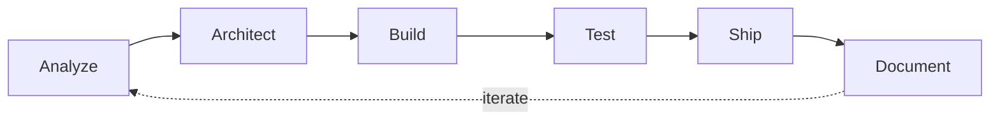
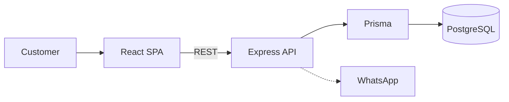

<!-- Banner -->
<p align="center">
  
</p>

<p align="center">
  <a href="https://github.com/sebastianjaimesr">
    
  </a>
</p>

<p align="center">
  
  
  
  
</p>

<p align="center">
  <a href="https://www.linkedin.com/in/sebastian-jaimes-1a2259398/"></a>
  <a href="mailto:jsrolon01@gmail.com"></a>
  <a href="https://sebastianjaimesr.github.io/emirate-scents/"></a>
</p>

---

## `$ whoami`

```ts
const sebastian = {
  role:        "Full-Stack Developer",
  based:       "Bucaramanga, Colombia · UTC−5",
  training:    "Campuslands — full-stack software development",
  focus:       ["Web apps end to end", "REST APIs", "Relational data", "Workflow automation"],
  stack: {
    frontend:  ["React 19", "TypeScript", "Vite", "Tailwind CSS", "Zustand", "Three.js"],
    backend:   ["Node.js", "Express 5", "Prisma", "Zod"],
    data:      ["PostgreSQL", "MySQL"],
    quality:   ["Vitest", "Supertest", "Playwright", "axe"],
    ops:       ["GitHub Actions", "GitHub Pages", "Docker", "n8n"],
  },
  principles: [
    "The server is the source of truth — never trust the client",
    "Validate every input, test every business rule",
    "Accessibility is a feature, not a polish step",
    "No invented data: demo content is always labeled as demo",
  ],
  lookingFor:  "Junior Full-Stack / Software Engineer role on a remote, international team",
} as const;
```

---

## 🧭 How I build

Every project follows the same loop: understand the problem, design the data model and layers, write typed and validated code, test it (unit · API · E2E · accessibility), ship it through CI/CD, and document the decisions.



---

## 🚀 Featured work

### 🛍️ Emirate Scents — full-stack e-commerce

<p>
  <a href="https://github.com/sebastianjaimesr/emirate-scents"></a>
  <a href="https://sebastianjaimesr.github.io/emirate-scents/"></a>
  
</p>

Online perfume store with search, filters, cart, favorites and WhatsApp-based checkout — built in **8 documented phases**, from architecture analysis to production readiness.



| What | How |
| --- | --- |
| **Layered API** | Routes → Zod validators → controllers → services. Business rules live in one place; the server owns prices and stock. |
| **3 test layers** | Vitest unit tests · Supertest API tests on an isolated database · Playwright E2E with automated **axe** accessibility checks (desktop + mobile). |
| **Hardened** | Validated env, helmet, CORS policy, request limits, structured logging (pino). |
| **Shipped** | GitHub Actions deploys a static preview to GitHub Pages on every push to `main`. |

---

<table>
  <tr>
    <td width="50%" valign="top">
      <h3>🤖 AgendaBot</h3>
      <p>Telegram assistant for appointments, tasks, habits, reminders and productivity reports.</p>
      <ul>
        <li>Refactored <b>8 separate workflows into one data-driven router</b> (routing table).</li>
        <li>Replaced unreliable parallel merges with deterministic sequential chains.</li>
        <li>Zero-cost stack: self-hosted n8n + Google Sheets.</li>
      </ul>
      <p>
        
        
        
      </p>
      <a href="https://github.com/sebastianjaimesr/N8N_Proyecto"><b>View repository →</b></a>
    </td>
    <td width="50%" valign="top">
      <h3>🛒 Undergold</h3>
      <p>Streetwear store with public catalog, cart, two-step checkout and an admin dashboard with full CRUD.</p>
      <ul>
        <li>Built with <b>native Web Components</b> and ES modules — no frameworks.</li>
        <li>Single persistence module owns all browser-storage access.</li>
        <li>Field-level validation and inline confirmations.</li>
      </ul>
      <p>
        
        
        
      </p>
      <a href="https://github.com/sebastianjaimesr/E-COMMERCE_Proyecto"><b>View repository →</b></a>
    </td>
  </tr>
  <tr>
    <td width="50%" valign="top">
      <h3>🏠 Real Estate DB</h3>
      <p>Relational database prototype for a real-estate business: normalized schema (DDL), seed data (DML) and test queries.</p>
      <p>
        
        
      </p>
      <a href="https://github.com/sebastianjaimesr/SQL_Proyecto"><b>View repository →</b></a>
    </td>
    <td width="50%" valign="top">
      <h3>🚀 Space Rides</h3>
      <p>Mobile app prototype for booking space trips — pure HTML5 and CSS3, no JavaScript, no dependencies.</p>
      <p>
        
        
      </p>
      <a href="https://github.com/sebastianjaimesr/HTML_CSS_Proyecto"><b>Repository</b></a> ·
      <a href="https://sebastianjaimesr.github.io/HTML_CSS_Proyecto/"><b>Live demo →</b></a>
    </td>
  </tr>
</table>

---

## 🧰 Toolbox

<p align="center">
  
</p>

<p align="center">
  
  
  
  
  
  
</p>

---

## 📈 Activity

<p align="center">
  
  
</p>

---

## 🤝 Let's build something

I'm looking for a **junior full-stack / software engineering role** on a remote, international team — and I'm open to internships and freelance projects.

**The fastest way to reach me:** [jsrolon01@gmail.com](mailto:jsrolon01@gmail.com) · [LinkedIn](https://www.linkedin.com/in/sebastian-jaimes-1a2259398/)

<details>
<summary>🇪🇸 <b>Resumen en español</b></summary>
<br />

Soy desarrollador full-stack de Bucaramanga, Colombia, formado en Campuslands. Construyo aplicaciones web completas con **React, TypeScript, Node.js/Express y PostgreSQL**, con validación, pruebas automatizadas y accesibilidad desde el inicio, y automatizo procesos con **n8n**. Busco mi primer rol como desarrollador en un equipo internacional y remoto. Escríbeme a [jsrolon01@gmail.com](mailto:jsrolon01@gmail.com).

</details>

<p align="center">
  
</p>
