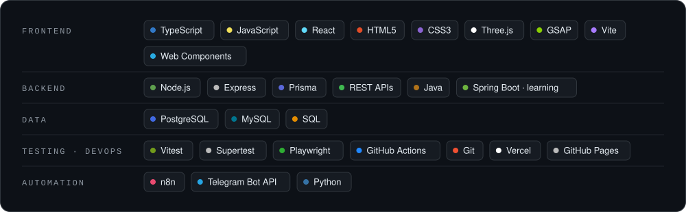
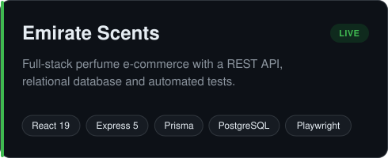
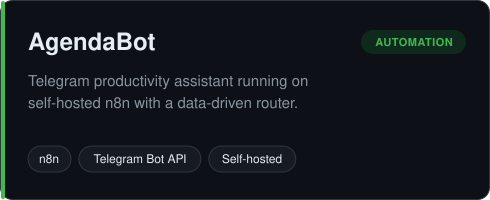
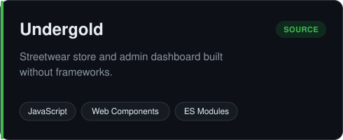
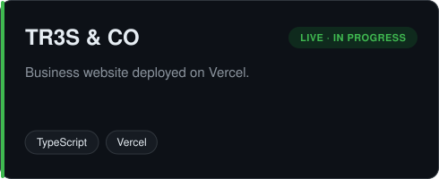
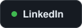
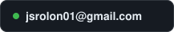
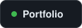

  

### Skills

### Selected work

<table>
  <tr>
    <td width="50%">
      
      
<a href="https://sebastianjaimesr.github.io/emirate-scents/">Live demo</a> · <a href="https://github.com/sebastianjaimesr/emirate-scents">Source</a>

    </td>
    <td width="50%">
      
      
<a href="https://github.com/sebastianjaimesr/N8N_Proyecto">Source</a>

    </td>
  </tr>
  <tr>
    <td width="50%">
      
      
<a href="https://github.com/sebastianjaimesr/E-COMMERCE_Proyecto">Source</a>

    </td>
    <td width="50%">
      
      
<a href="https://tr3s-co.vercel.app">Live site</a> · <a href="https://github.com/sebastianjaimesr/TR3S-CO-">Source</a>

    </td>
  </tr>
</table>

### Contact

  &nbsp;
  &nbsp;
  

